<div align="center">


**An internet-exposed MySQL server, a remote `root` login, and a database wiped 26 hours later.**


</div>

---

## TL;DR

An attacker logged into MySQL on `corp-retail-group` from the internet as `root` on **Oct 10, 2026**, and on **Oct 12 at 00:10** left a ransom note (0.0101 BTC, 48 hours), dropped three databases (including `bby_corp`), purged the binary logs and shut the server down. Root logins from attacker-linked addresses continued for five more days. Every failed external MySQL logon was a passwordless probe and no wrong-password attempt is logged, so the `root` credential was most likely already known, reused or empty (source not determined).

The ransom note claims the data was copied first. **The logs do not confirm that**, and this report says so rather than guessing.

| | |
|---|---|
| **Type** | Database extortion following unauthorized remote root access (no file encryption) |
| **Initial access** | Oct 10, 2026 21:35 — first external `root` logon |
| **Impact event** | Oct 12, 2026 00:10:43 – 00:11:01 |
| **Data sources** | Microsoft Defender Advanced Hunting (5 tables) + MySQL audit log |
| **Full report** | [`report/incident-report.md`](report/incident-report.md) |

## Attack chain

```mermaid
flowchart LR
    A["Internet-exposed MySQL<br/>port open to the world"] --> B["Passwordless probes<br/>root / admin / sa<br/>from Oct 10 20:19"]
    B --> C["Valid root logon<br/>Oct 10 21:35"]
    C --> E["Ransom note written<br/>RECOVER_YOUR_DATA<br/>Oct 12 00:10:43"]
    E --> D["Schema discovery<br/>size and column queries"]
    D --> F["DROP DATABASE x3<br/>lnp_corp, sakila, world"]
    F --> G["PURGE BINARY LOGS<br/>RESET MASTER"]
    G --> H["SHUTDOWN"]
    H --> I["Root logons continue<br/>to Oct 17"]
    style F fill:#c0392b,color:#fff
    style G fill:#c0392b,color:#fff
    style E fill:#e67e22,color:#fff
```



## MITRE ATT&CK mapping

| Tactic | Technique | Evidence |
|---|---|---|
| Initial Access | T1133 External Remote Services | MySQL listening on `0.0.0.0`; inbound connections from public IPs |
| Credential Access | T1110.001 Password Guessing (Windows only) | 297 failed `administrator` network logons. The 461 failed external MySQL logons were passwordless probes, not password guesses |
| Initial Access / Persistence | T1078 Valid Accounts | Successful remote `root` logons from Oct 10 21:35, with no wrong-password attempts before them |
| Impact | T1485 Data Destruction | `DROP DATABASE` on `lnp_corp`, `sakila`, `world` |
| Defense Evasion | T1070 Indicator Removal | `PURGE BINARY LOGS`, `RESET MASTER` |
| Impact | T1529 System Shutdown/Reboot | `SHUTDOWN` at 00:11:01 |
| Impact | T1657 Financial Theft (extortion) | Ransom note: 0.0101 BTC in 48 hours |

## What the logs could *not* tell us

Good incident reports say what they don't know. This one lists:

- **Whether data was stolen** — no row-level reads of business tables, and no outbound transfer in Defender data.
- **Which credential worked, and where it came from** — successful logons don't record the password, and no wrong-password attempt is logged, so it was likely already known, reused or empty.
- **Detection and response times** — no alert, ticket or responder action in the logs.
- **The attack window itself on the host** — Defender network and file telemetry start ~20 hours after the destruction.
- **Whether the Windows `administrator` logons are related** — guessing began Oct 11 02:15, before the DB attack, but the first successful logon is ~20 hours after it, and nothing links the two.

## Repo guide

```
├── report/incident-report.md      Full 9-section incident report
├── detections/
│   ├── hunts/                     12 KQL hunts (Defender Advanced Hunting)
│   └── alerts/                    2 candidate detection rules
├── iocs/iocs.csv                  Defanged indicators (observed vs unverified)
├── evidence/screenshots/          Query result screenshots
├── docs/PUBLISHING_CHECKLIST.md   Redaction steps before going public
└── data/                          Raw log exports (git-ignored)
```

Every KQL file starts with a header giving its purpose, MITRE technique and source tables. All queries run in **Defender Advanced Hunting (UTC)**. The MySQL audit statements cited in the report come from a Log Analytics export and can't be queried there.

## Top recommendations

1. Take MySQL off the internet — bind to a private address, allow only named hosts or VPN.
2. Remove remote `root`, rotate its password, and use per-application accounts with connection throttling.
3. Close Remote Desktop exposure for the Windows `administrator` account.
4. Keep immutable off-host backups and ship binary logs elsewhere.
5. Alert on success-after-guessing and on `DROP DATABASE` / `PURGE BINARY LOGS` / `SHUTDOWN`.
6. Onboard database hosts to Defender before an incident and log full query text.

## Skills demonstrated

Incident response lifecycle · KQL threat hunting · log correlation across Defender and MySQL audit data · MITRE ATT&CK mapping · IOC handling and defanging · writing for both technical and executive readers · stating evidence limits honestly.

---

<sub>Educational / portfolio project built from lab telemetry. IOCs are defanged. Not affiliated with any vendor.</sub>

